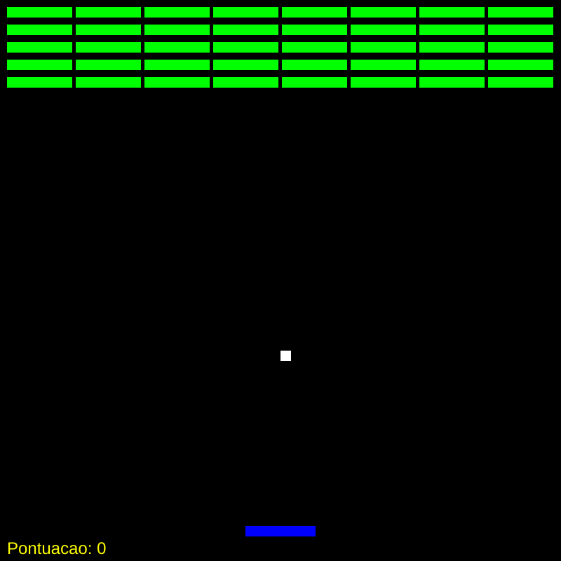

# Brick Breaker

Um jogo simples de quebrar blocos desenvolvido em Python com Pygame. Controle a
plataforma para rebater a bola, destrua todos os blocos e tente alcançar a maior
pontuação.

## Visual do jogo



## Requisitos

- Python 3
- Pygame

## Instalação

No terminal, acesse a pasta do projeto e instale o Pygame:

```bash
python -m pip install pygame
```

## Como executar

Na pasta onde está o arquivo `brick_breaker.py`, execute:

```bash
python brick_breaker.py
```

## Controles

| Teclas | Ação |
| --- | --- |
| `←` / `A` | Mover a plataforma para a esquerda |
| `→` / `D` | Mover a plataforma para a direita |
| `R` | Iniciar uma nova partida após a vitória ou o Game Over |
| `Esc` / `Q` | Sair da tela de fim de jogo |

Também é possível fechar a janela do jogo para sair.

## Objetivo

Rebata a bola com a plataforma para eliminar os blocos. A pontuação aumenta a
cada bloco destruído. Se a bola cair, acontece o Game Over; se todos os blocos
forem destruídos, você vence. Na tela final, pressione `R` para jogar novamente
sem precisar executar o programa outra vez.
